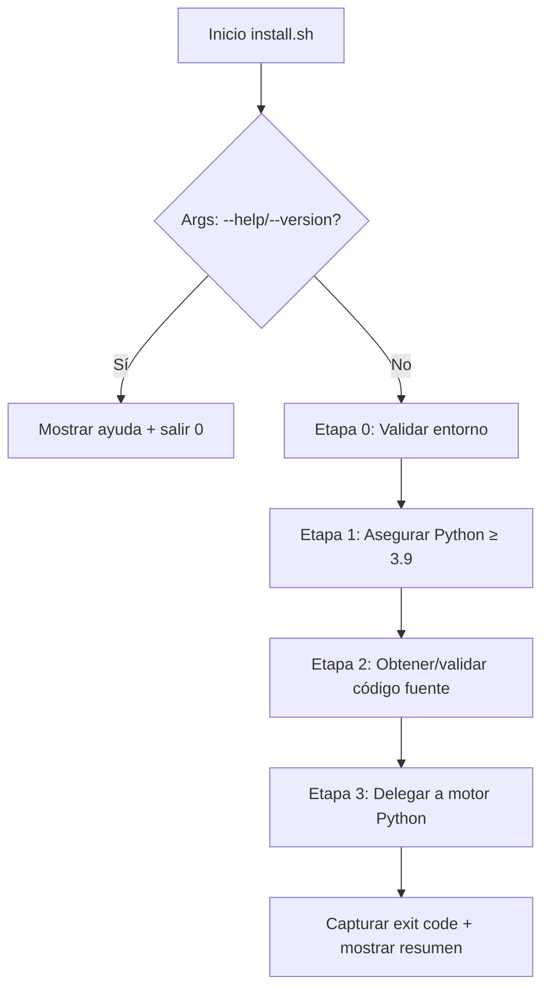

# Especificación del Bootstrap (`install.sh`)

## Objetivo

`install.sh` es el **único punto de entrada** que el usuario ejecuta. Debe:
1. Funcionar en **cualquier Linux** con Bash POSIX-ish (sin `bashisms` innecesarios)
2. Verificar/obtener **Python ≥ 3.9** (piso del motor)
3. Validar **integridad** del código descargado (hash SHA-256)
4. Delegar en el motor Python (`python3 -m thorrija ...`)
5. **Nunca** ejecutar código remoto sin verificación (`curl | bash` prohibido)

---

## Flujo del Bootstrap (Etapas)



### Etapa 0: Validar Entorno

```bash
# Requisitos mínimos para el propio bootstrap
- Bash ≥ 4.0 (verificado con BASH_VERSION)
- Comandos disponibles: curl/wget, tar, sha256sum, mktemp, grep, sed, awk
- Directorio temporal escribible (TMPDIR o /tmp)
- No root (rechaza si EUID == 0 con mensaje: "No ejecutes como root. Usa usuario normal; sudo se pedirá cuando haga falta")
```

### Etapa 1: Asegurar Python ≥ 3.9

**Estrategia en orden de preferencia:**

| Orden | Estrategia | Detalle |
|-------|------------|---------|
| 1 | **Python ya presente** | `python3 --version` parse → mayor/igual 3.9 → usar ese |
| 2 | **python3.11 / python3.10 / python3.9** binario específico | Busca en PATH `python3.11`, `python3.10`, `python3.9` |
| 3 | **Instalar via gestor nativo** (con confirmación) | Detecta distro → muestra comando exacto → pide `s/N` → ejecuta con sudo |
| 4 | **Fallar con instrucciones claras** | Si no hay gestor soportado o usuario rechaza → exit 1 con mensaje de qué instalar manualmente |

**Detección de distro para Paso 3** (reutiliza lógica ligera de `os_detect.py` pero en Bash):
```bash
# Lee /etc/os-release
. /etc/os-release
case "$ID" in
  arch|manjaro|endeavouros) PKG_CMD="pacman -S --needed --noconfirm python" ;;
  debian|ubuntu|linuxmint|pop) PKG_CMD="apt-get update && apt-get install -y python3 python3-venv" ;;
  fedora|rhel|centos|almalinux|rocky) PKG_CMD="dnf install -y python3" ;;
  void) PKG_CMD="xbps-install -Sy python3" ;;
  *) PKG_CMD="" ;; # Desconocido → salta a paso 4
esac
```

**Mensaje al usuario (Paso 3):**
```
Python ≥ 3.9 no encontrado en el sistema.

Se puede instalar automáticamente con el gestor de paquetes de tu distro:
  Comando: sudo pacman -S --needed --noconfirm python
  (Detectado: Arch Linux)

¿Ejecutar este comando con sudo? [s/N]:
```
- Si `s`/`S`/`y`/`Y` → ejecuta, verifica versión, continúa
- Si `n`/`N`/Enter → va a Paso 4

**Paso 4 — Fallo controlado:**
```
No se pudo obtener Python ≥ 3.9 automáticamente.

Instala manualmente uno de:
  - python3.11  (recomendado)
  - python3.10
  - python3.9

Y vuelve a ejecutar este script.

Arch Linux:    sudo pacman -S python
Debian/Ubuntu: sudo apt-get install python3.11
Fedora:        sudo dnf install python3.11
Void:          sudo xbps-install -Sy python3.11
```

### Etapa 2: Obtener y Validar Código Fuente

Dos orígenes posibles (controlado por variable interna / flag):

#### A. Desde GitHub Release (Producción / Usuario Final)

```bash
REPO="ThorrijaDEV/thorrija-environment"
VERSION="v0.1.0"  # O "latest" resuelto via API
TARBALL_URL="https://github.com/${REPO}/releases/download/${VERSION}/thorrija-environment-${VERSION}.tar.gz"
SHA256_EXPECTED="a1b2c3d4e5f6..."  # HARDCODEADO en el script, actualizado en cada release
```

1. Descarga a `$TMPDIR/thorrija-XXXXXX.tar.gz` (con `curl -fsSL` o `wget -qO`)
2. `sha256sum` del archivo descargado
3. Compara con `SHA256_EXPECTED`
4. Si **match** → extrae a `$TMPDIR/thorrija-XXXXXX/`
5. Si **mismatch** → **ABORTA** con error:
   ```
   ERROR: Integridad del instalador comprometida.
   Hash esperado: a1b2c3d4e5f6...
   Hash real:     f6e5d4c3b2a1...
   No continúes. Descarga manualmente desde:
   https://github.com/ThorrijaDEV/thorrija-environment/releases
   ```

#### B. Desde Clone Local (Desarrollo / `--dev`)

```bash
# Si el script se ejecuta desde dentro del repo clonado (./install.sh)
# Detecta .git y usa ese código directamente (sin descarga, sin hash)
# Útil para desarrollo: git clone ... && cd thorrija-environment && ./install.sh --dev
```

### Etapa 3: Delegar al Motor Python

```bash
cd "$EXTRACTED_DIR"  # o directorio del repo clonado
export THORRIJA_BOOTSTRAP=1  # Flag para que el motor sepa que viene del bootstrap
exec python3 -m thorrija "$@"
# Los args originales (--detect, --profile standard, --plan, --yes, etc.) se pasan tal cual
```

**El motor Python (`src/thorrija/__main__.py` o `cli.py`) recibe:**
- `sys.argv[1:]` = flags del usuario
- `os.environ["THORRIJA_BOOTSTRAP"] = "1"`
- CWD = directorio del código fuente (con `catalog/`, `profiles/`, `src/`)

---

## Alternativas Cuando Python No Está Disponible

Ya cubiertas en **Etapa 1** (pasos 1–4). Resumen:

| Escenario | Resolución |
|-----------|------------|
| Python 3.11+ en PATH | Usar directamente (preferido: `tomllib` en stdlib) |
| Python 3.9/3.10 en PATH | Usar + motor carga `tomli` (vendido como 1 archivo en `src/thorrija/_vendor/tomli.py`) |
| Solo `python3.11`/`python3.10`/`python3.9` en PATH | Usar ese binario específico |
| Python < 3.9 o ninguno | Ofrecer instalar via gestor nativo (con confirmación) |
| Usuario rechaza auto-instalación | Instrucciones manuales claras + exit 1 |
| Distro no reconocida (sin gestor conocido) | Instrucciones genéricas + exit 1 |
| Sin internet (para instalar Python) | Instrucciones: "Descarga Python de python.org o usa gestor offline" + exit 1 |

**Nota sobre `tomli`**: El motor incluye `tomli` como vendored (single file, ~50 KB, licencia MIT) para Python 3.9/3.10. En 3.11+ usa `tomllib` nativo. **Cero dependencias externas en bootstrap**.

---

## Flags del Bootstrap (`install.sh`)

| Flag | Descripción |
|------|-------------|
| `--help`, `-h` | Muestra ayuda del bootstrap (no del motor) y sale |
| `--version`, `-V` | Muestra versión del bootstrap (hardcodeada en script) y sale |
| `--dev` | Modo desarrollo: usa código local (detecta `.git`), sin descarga/hash |
| `--offline` | **No implementado en FASE 1** — reservado para FASE 4; muestra "Modo offline no disponible en esta versión" y sale 1 |
| `--verify-only` | Solo verifica hash del tarball (si modo release) y sale |
| `--python PATH` | Fuerza uso de binario Python específico (salta detección) |
| `--no-python-check` | Peligroso: salta verificación versión Python (solo para testing) |

**Todos los demás flags** (`--detect`, `--profile`, `--plan`, `--category`, `--yes`, `--audit`, `--update`, `--resume`, etc.) **se pasan tal cual al motor Python**. El bootstrap no los parsea.

---

## Seguridad del Bootstrap

| Medida | Implementación |
|--------|----------------|
| Hash hardcodeado | `SHA256_EXPECTED="..."` en el script; actualizado en cada release via CI |
| Sin `curl \| bash` | Descarga → verifica hash → extrae → ejecuta Python local |
| Sin root | Rechaza `EUID == 0` al inicio |
| Temporal seguro | `mktemp -d` con permisos 700; limpieza en `trap` |
| Args passthrough | `"$@"` sin eval ni manipulación |
| Variables de entorno | Solo `THORRIJA_BOOTSTRAP=1` + `TMPDIR` respetado |

---

## Actualización del Bootstrap (`--update`)

**Flujo futuro (FASE 2+):**
```bash
./install.sh --update
# 1. Llama a GitHub API: latest release tag
# 2. Compara con versión actual (hardcodeada en script)
# 3. Si hay nueva: descarga NUEVO install.sh a archivo temporal
# 4. Verifica hash del NUEVO script (hash viene en release notes / asset separado)
# 5. Si OK: reemplaza install.sh actual (backup .bak)
# 6. Ejecuta nuevo script con mismos args
```

**FASE 1**: `--update` no implementado; motor Python tendrá su propio `--update` para actualizar catálogo/manifiestos.

---

## Testing del Bootstrap (FASE 2)

| Test | Descripción |
|------|-------------|
| `test_bootstrap_python_detection.sh` | Matrix: Python 3.8, 3.9, 3.10, 3.11, 3.12, 3.13, none |
| `test_bootstrap_hash_verification.sh` | Hash correcto / incorrecto / archivo corrupto |
| `test_bootstrap_distro_detection.sh` | /etc/os-release para Arch, Debian, Ubuntu, Fedora, Void, desconocido |
| `test_bootstrap_args_passthrough.sh` | Flags varios pasados al motor intactos |
| `test_bootstrap_root_rejection.sh` | EUID=0 → rechazo claro |
| `test_bootstrap_dev_mode.sh` | Ejecución desde repo clonado (`.git` presente) |

---

## Ejemplo Mínimo de `install.sh` (Esqueleto)

```bash
#!/usr/bin/env bash
# install.sh — Thorrija Environment Bootstrap
# Version: 0.1.0-dev
# SHA256 del tarball release: ACTUALIZAR_EN_CI

set -euo pipefail

# --- Config ---
REPO="ThorrijaDEV/thorrija-environment"
RELEASE_VERSION="latest"  # o tag específico
SHA256_EXPECTED="PENDING_RELEASE_HASH"  # CI lo reemplaza
# --- Fin Config ---

usage() {
  cat <<'EOF'
Thorrija Environment — Bootstrap Installer

Uso: ./install.sh [OPCIONES_BOOTSTRAP] -- [OPCIONES_MOTOR]

Opciones del bootstrap:
  -h, --help           Muestra esta ayuda
  -V, --version        Versión del bootstrap
      --dev            Modo desarrollo (usa código local, sin descarga)
      --verify-only    Solo verifica hash del tarball (modo release)
      --python PATH    Forzar binario Python
      --no-python-check Saltar verificación versión Python (peligroso)

Todas las demás opciones se pasan al motor Python.
Ejemplos:
  ./install.sh -- --detect
  ./install.sh -- --profile standard --plan
  ./install.sh -- --profile standard --yes
EOF
}

# --- Parseo args bootstrap (hasta -- o fin) ---
BOOTSTRAP_ARGS=()
ENGINE_ARGS=()
PASSTHROUGH=0
for arg in "$@"; do
  if [[ $PASSTHROUGH -eq 1 ]]; then
    ENGINE_ARGS+=("$arg")
  elif [[ "$arg" == "--" ]]; then
    PASSTHROUGH=1
  elif [[ "$arg" =~ ^(--help|-h|--version|-V|--dev|--verify-only|--python|--no-python-check)$ ]]; then
    BOOTSTRAP_ARGS+=("$arg")
  else
    ENGINE_ARGS+=("$arg")
  fi
done

# ... implementación etapas 0-3 ...

# Delegación final
exec python3 -m thorrija "${ENGINE_ARGS[@]}"
```

---

## Decisiones Pendientes

| Tema | Opciones | Notas |
|------|----------|-------|
| Vendoring `tomli` | Incluir como `_vendor/tomli.py` vs `pip install --target` | Single file = más simple, cero deps |
| Auto-update del bootstrap | `--update` en bootstrap vs solo motor | Bootstrap auto-update es UX superior pero más complejo |
| Soporte `uv` / `pipx` para motor | ¿Permitir `uv run --python 3.11 -m thorrija`? | Podría simplificar Python detection |
| Windows (WSL2) | ¿Bootstrap .ps1 paralelo? | FASE 4+ |
| Firmas cosign | Verificar firma del tarball además de hash | FASE 2+ con sigstore |